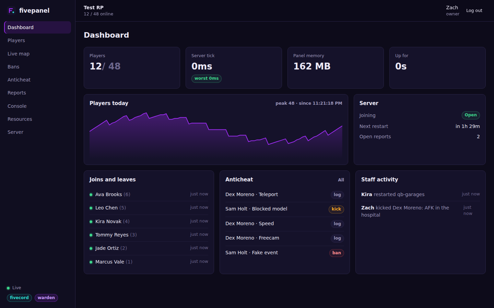
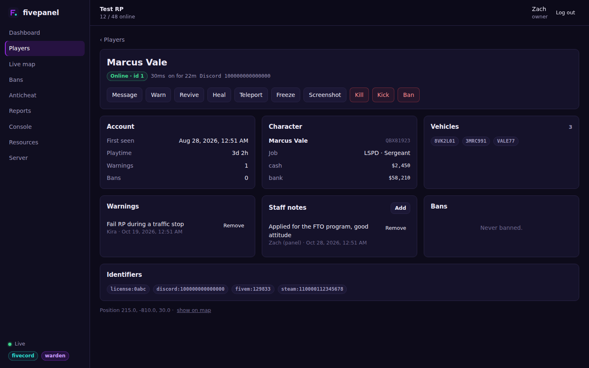
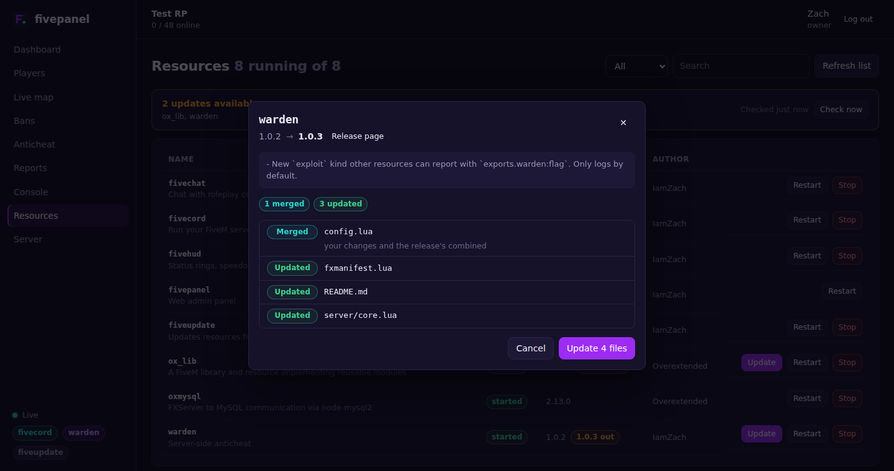

# fivepanel

A web admin panel for your FiveM server. Staff log in with Discord and get a live player list, a map, player profiles with every action one click away, bans, the anticheat feed, reports, the server console, resources and server controls.

It runs inside your server as a normal resource, so there's nothing else to host. It works on its own, and does a lot more next to [fivecord](https://github.com/1amZach/fivecord), [warden](https://github.com/1amZach/warden), [fivelog](https://github.com/1amZach/fivelog) and [fiveupdate](https://github.com/1amZach/fiveupdate).



## Pages

- **Dashboard:** players online, server tick time, uptime, a player count chart, joins and leaves, recent detections and what staff have done, here or in game with [fiveadmin](https://github.com/1amZach/fiveadmin).
- **Players:** everyone online with ping and playtime, plus a search across everyone who has ever joined.
- **Player profile:** account, playtime, character, job, money, vehicles, warnings, staff notes, ban history, identifiers and recent activity. From here you can message, warn, revive, heal, teleport, freeze, screenshot, record a short clip, kill, kick or ban them.
- **Live map:** every player's position, updated every 2 seconds. Scroll to zoom, drag to move, click a dot to open the player.
- **Bans:** search, see who banned whom and why, lift a ban.
- **Anticheat:** warden's detections as they happen, with screenshots and video clips for kicks and bans, and a one-click ban or dismiss.
- **Logs:** kills, damage, chat, money, items, spawned vehicles and joins from fivelog. Filter by kind, day, text or player. New lines show up as they happen.
- **Reports:** in-game `/report`s as a chat. Claim, reply (it shows in the player's chat) and close.
- **Console:** the live server console, and a box to run commands.
- **Resources:** start, stop and restart any resource, and pick up new ones. With fiveupdate, see which have a new release on GitHub, preview exactly which files an update changes, update with your config edits kept, and undo it.
- **Server:** lock the server for maintenance, schedule or cancel a restart, set the weather and time, send an announcement, kick everyone.



## What needs what

| | On its own | With fivecord | With warden |
|---|---|---|---|
| Dashboard, live map, console, resources | yes | | |
| Player list, kick, message, screenshot | yes | | |
| Profiles, warnings, notes, all player actions | | yes | |
| Bans | | every ban | warden's own |
| Anticheat feed | | | yes |
| Reports, server lock, scheduled restarts | | yes | |
| Weather, time, announcements | yes | | |

The Logs page and players' recent activity need fivelog. Updates on the Resources page need fiveupdate. Screenshots need fivecapture or screenshot-basic, and video clips need fivecapture.



Staff levels come from fivecord when it's running, so the panel and the Discord commands always agree on who can do what, `Config.permissions` included. Every action taken in the panel is logged to fivecord's staff channel with the staff member's name.

## Install

1. In the [Discord developer portal](https://discord.com/developers/applications), open your application (the fivecord bot's is fine), go to **OAuth2** and add a redirect:

   ```
   http://your-server-ip:40120/auth/callback
   ```

   Copy the **Client ID** and **Client Secret** from the same page.

2. Download `fivepanel.zip` from the [releases](https://github.com/1amZach/fivepanel/releases), put the `fivepanel` folder in your resources, and add to `server.cfg`:

   ```
   set fivepanel_discord_id "your client id"
   set fivepanel_discord_secret "your client secret"
   set fivepanel_url "http://your-server-ip:40120"
   ensure fivepanel
   ```

3. Open the port (`40120` TCP by default) in your firewall, then go to the URL and log in.

### Who gets in

With fivecord running, anyone fivecord sees as staff can log in, at the same level.

Without fivecord, list staff by Discord id in `config.json`:

```json
"staff": {
    "123456789012345678": "owner",
    "234567890123456789": "mod"
}
```

or use aces, named `fivepanel.<level>`:

```
add_principal identifier.discord:123456789012345678 group.admin
add_ace group.admin fivepanel.admin allow
```

What each level can do follows the same defaults as fivecord. The Logs page is mod and up by default; change it with `"logs"` in `permissions`. Anyone who can see Resources sees which updates are out, but running them is owner only, since it writes files on the server; change it with `"resource update"`. Recording clips is mod and up (`"record"`), and warden's clips can be watched by anyone who can see bans. Change them with `permissions` in `config.json`, using the same names fivecord uses (`"kick": "admin"`, `"server restart": "owner"`).

### HTTPS

The panel speaks plain HTTP. Put it behind a reverse proxy like Caddy or nginx with a certificate and set `fivepanel_url` to the `https://` address. The login cookie is then marked secure. With Caddy that's all it takes:

```
panel.yourserver.com {
    reverse_proxy 127.0.0.1:40120
}
```

Then `set fivepanel_host "127.0.0.1"` so the panel only listens locally.

## Config

`server.cfg`:

| Convar | Default | |
|---|---|---|
| `fivepanel_discord_id` | | OAuth2 client id |
| `fivepanel_discord_secret` | | OAuth2 client secret |
| `fivepanel_url` | `http://localhost:40120` | Where staff open the panel. Must match the redirect in Discord |
| `fivepanel_port` | `40120` | |
| `fivepanel_host` | `0.0.0.0` | `127.0.0.1` behind a proxy |
| `fivepanel_secret` | made for you | Signs login cookies. Kept in `secret.key` if you don't set it |

`config.json`:

| Key | |
|---|---|
| `staff` | Discord id to level, for when fivecord isn't running |
| `tiers` | Level names, lowest first |
| `permissions` | Change what a level can do |
| `map.image` | A map picture in the resource folder, like `map.jpg`. Without one the map is a grid with coordinates |
| `map.bounds` | World coordinates at the picture's left, bottom, right and top edges |
| `weatherCommand`, `timeCommand` | Commands run for weather and time when fivecord isn't running |

Logins last 12 hours.

## Building from source

The release zip has everything built. To change the panel:

```
npm install
npm run build
npm test
```

`src` is the server, `web` is the Svelte app. `npm run dev` serves the app with hot reload and sends API calls to a panel running on `localhost:40120`, or wherever `PANEL` points.

## Support

Made by **IamZach**. Questions, bugs or ideas: [discord.gg/agn](https://discord.gg/agn)

## License

MIT
